# Dal potenziale al caos – testo per lo studente

Questo è il racconto di una domanda sola, che da un'osservazione elementare porta a uno dei temi più affascinanti della fisica contemporanea: *che cosa accade a una carica che si muove in uno spazio dove altre cariche hanno steso un paesaggio invisibile?* Per rispondere dovremo imparare a disegnare quel paesaggio, a seguire un viandante che lo attraversa, a chiederci dove finiscono tutti i suoi viaggi possibili e, infine, a scoprire che esistono percorsi di cui nessuna misura, per quanto accurata, potrà dirci il destino.

Il testo accompagna il Laboratorio del potenziale elettrostatico: leggi una sezione, poi prova sul simulatore quello che hai letto. Le parti più importanti sono messe in evidenza così:

> **Idea chiave.** Il pensiero da portare a casa al termine di ogni sezione.

> **Definizione.** Un termine tecnico, enunciato con precisione.

> **Prova sul laboratorio.** Un'azione da compiere sul simulatore. Prima di eseguirla, formula una previsione.

## Come usare il laboratorio

Il laboratorio è la tua lente d'ingrandimento: una pagina web che calcola il potenziale e il moto delle cariche mentre le sposti con il mouse. A sinistra trovi la mappa vista dall'alto, a destra un secondo grafico (la superficie in tre dimensioni oppure lo spazio delle fasi), sotto una barra di comandi, e sul lato destro tre schede che corrispondono alle parti di questo testo.

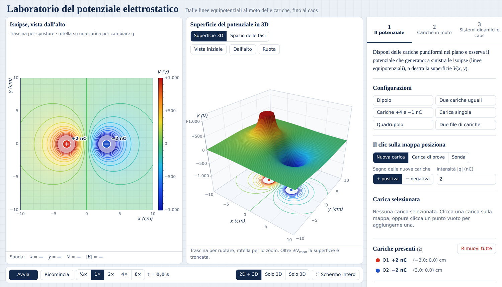

*Figura 0 – Il laboratorio con il dipolo: mappa delle isoipse a sinistra, superficie 3D al centro, schede dei comandi a destra.*

| Se vuoi… | fai così |
| --- | --- |
| aggiungere una carica | clic su un punto vuoto della mappa (scheda 1, «Il clic sulla mappa posiziona: Nuova carica») |
| spostare una carica | trascinala; con le frecce della tastiera la sposti di 1 mm |
| cambiare il valore di una carica | rotella del mouse sopra la carica, oppure il cursore nella scheda 1 |
| misurare V e il campo in un punto | passa con il mouse sulla mappa: i valori compaiono sotto la mappa |
| ruotare la superficie 3D | trascina il grafico di destra; la rotella fa lo zoom |
| far partire una simulazione | «Avvia» nella barra sotto i grafici, oppure la barra spaziatrice |
| vedere un solo grafico in grande | «Solo 2D» o «Solo 3D», poi «Schermo intero» (tasto F, Esc per uscire) |

Le unità sono sempre le stesse: distanze in centimetri, cariche in nanocoulomb (1 nC = 10⁻⁹ C), potenziale in volt, campo in V/m.

## 1 · Dalla forza di Coulomb al potenziale

Tutto comincia da una forza. Due cariche elettriche si attirano o si respingono, e lo fanno con un'intensità che Charles Coulomb misurò nel 1785 con una bilancia di torsione: proporzionale al prodotto delle cariche e inversamente proporzionale al quadrato della loro distanza.

```latex
F = k\,\frac{q\,q_0}{r^2}, \qquad k = 8{,}99\cdot 10^9\ \text{N·m}^2/\text{C}^2
```

Questa formula descrive una coppia di cariche, ma suggerisce subito un cambio di prospettiva. Se la forza su q₀ è proporzionale a q₀ stessa, possiamo dividere per q₀ e ottenere una quantità che non dipende più da chi la subisce: il campo elettrico. La carica q₀ diventa allora una semplice **carica di prova**, un osservatore così piccolo da non disturbare ciò che misura.

> **Definizione.** Il **campo elettrico** in un punto è la forza per unità di carica, E = F / q₀. È una proprietà del punto dello spazio: esiste anche se lì non c'è nessuna carica a «sentirlo».

**Un fatto sorprendente.** Spostiamo la carica di prova da un punto A a un punto B: la forza elettrica compie un lavoro. Si potrebbe pensare che dipenda dalla strada scelta; invece dipende soltanto dalle distanze iniziale e finale dalla carica che genera il campo. Una forza con questa proprietà si dice **conservativa**, e solo per le forze conservative ha senso parlare di energia potenziale: un'energia che «si trova» nella posizione e che il percorso non può alterare.

```latex
U = k\,\frac{q\,q_0}{r} \qquad \text{(zero quando la carica di prova è infinitamente lontana)}
```

L'energia potenziale, però, appartiene alla coppia di cariche. Ripetiamo il gesto di prima e dividiamo per q₀: ciò che resta è un numero associato a ogni punto dello spazio, e questo è il potenziale.

> **Definizione.** Il **potenziale elettrico** è l'energia potenziale per unità di carica, V = U / q₀; per una carica puntiforme vale V = kq/r. Si misura in volt (1 V = 1 J/C).

```latex
V = \frac{U}{q_0} = k\,\frac{q}{r}
```

Il potenziale dice quanta energia avrebbe ogni coulomb di carica posto in quel punto. Il lavoro della forza elettrica tra A e B si legge allora come una differenza di potenziale: W = q₀ (V\_A − V\_B).

C'è infine un vantaggio pratico che renderà possibile tutto il resto. Il campo è un vettore, e sommare i campi di molte cariche richiede di comporre frecce in direzioni diverse. Il potenziale è un numero: il potenziale di più cariche è la somma dei potenziali di ciascuna (**principio di sovrapposizione**), e una somma di numeri è un'operazione che possiamo fare in ogni punto di una mappa.

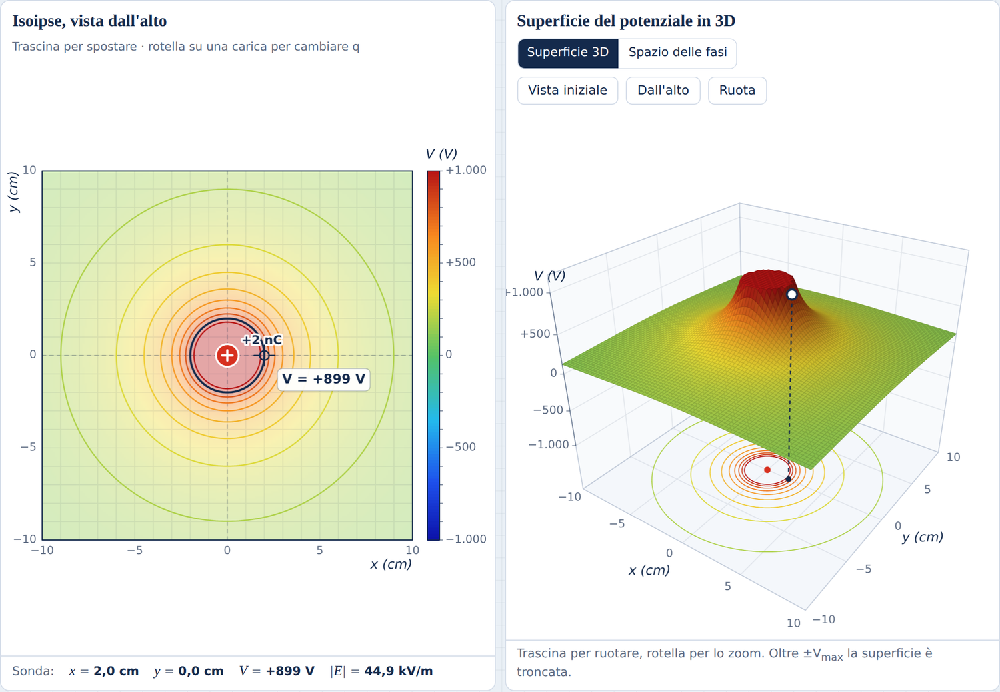

*Figura 1 – Una carica di +2 nC. La sonda, a 2 cm dalla carica, legge V ≈ +899 V.*

> **Idea chiave.** Il lavoro elettrico non dipende dal percorso: per questo esiste il potenziale, un numero in ogni punto dello spazio che racchiude, in forma più semplice, tutta l'informazione sul campo.

> **Prova sul laboratorio.** Scheda 1 → «Carica singola». Porta la sonda a 2 cm dalla carica e leggi V; poi portala a 4 cm. Il valore si dimezza? Ora calcola V a 2 cm con la formula, ricordando che 2 cm = 0,02 m e 2 nC = 2·10⁻⁹ C, e confronta.

Abbiamo un numero per ogni punto del piano. Ma come si fa a *vedere* un numero distribuito su un'intera regione? È la domanda della prossima sezione.

## 2 · Leggere il potenziale: isoipse e superficie

Un geografo che deve rappresentare una montagna su un foglio piano si trova di fronte allo stesso problema: ha una quota per ogni punto del terreno. Ha due soluzioni, e noi le adotteremo entrambe.

**Le isoipse.** Sulle carte topografiche le curve di livello uniscono i punti alla stessa quota. Allo stesso modo le **isoipse** (o linee equipotenziali) uniscono i punti con lo stesso potenziale. Nel laboratorio tra due isoipse vicine c'è sempre la stessa differenza di potenziale ΔV, indicata nella scheda 1: dove le curve si addensano, il potenziale cambia in fretta.

**La superficie.** Possiamo anche usare V come altezza e costruire un vero paesaggio: ogni carica positiva diventa un picco, ogni carica negativa un pozzo, e lontano dalle cariche il terreno è una pianura a quota zero.

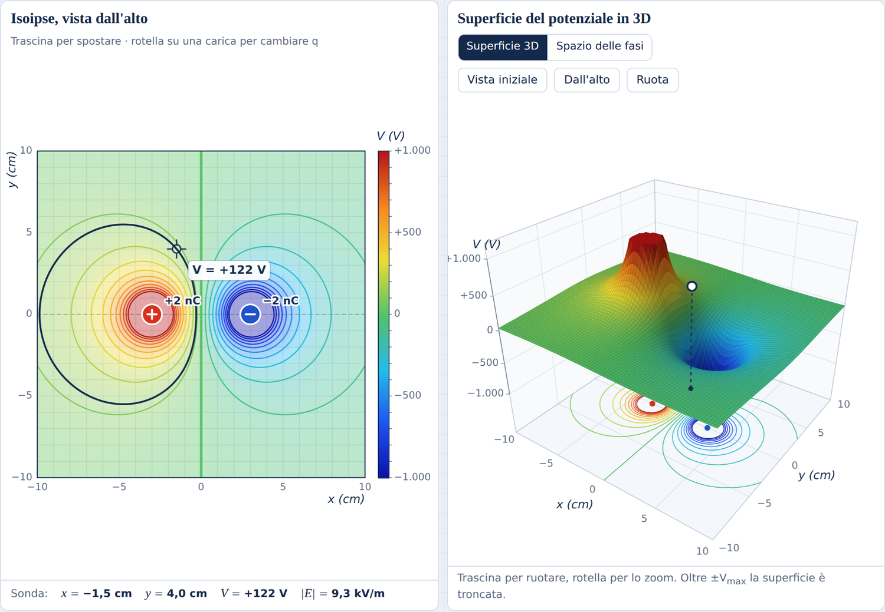

*Figura 2 – Il dipolo (+2 nC a sinistra, −2 nC a destra). A sinistra le isoipse: quella evidenziata passa per la sonda, dove V ≈ +122 V. A destra la stessa informazione come superficie: un picco e un pozzo.*

Nella figura si leggono tre fatti che valgono in generale:

1. Dove le isoipse sono fitte la superficie è ripida: il potenziale cambia in fretta.
2. Sull'asse verticale, esattamente a metà tra le due cariche, V = 0: i contributi delle due cariche si annullano.
3. Due isoipse diverse non si incrociano mai, perché in un punto il potenziale ha un solo valore.

Una precisazione onesta: la superficie è «tagliata» in cima e in fondo. Vicino a una carica V diventa grandissimo e non starebbe nel grafico, perciò il disegno si ferma al valore V\_max impostato nella scheda 1.

> **Idea chiave.** Isoipse e superficie sono la stessa informazione in due linguaggi: la mappa dice *dove* il potenziale ha un certo valore, il rilievo dice *quanto* è ripido il cambiamento.

> **Prova sul laboratorio.** Scheda 1 → «Due cariche uguali». Prima di guardare, disegna sul quaderno le isoipse che ti aspetti. Poi confronta. Al centro trovi un punto di sella: lungo la congiungente delle cariche il centro è il punto più basso, nella direzione perpendicolare è il più alto, come su una sella da cavallo.

> **Prova sul laboratorio.** Aggiungi una terza carica con un clic. Indovina come cambia la mappa, poi trascina la carica e osserva.

Un paesaggio, tuttavia, non è fatto solo per essere guardato: è fatto per essere percorso. Che cosa ci dice sul modo in cui una carica si muoverà?

## 3 · Campo e potenziale

Campo e potenziale non sono due cose diverse: sono due descrizioni della stessa situazione, e il paesaggio ci ha appena mostrato il legame. Una pallina appoggiata sul rilievo rotola lungo la linea di massima pendenza; il campo elettrico indica proprio questa direzione, quella in cui il potenziale scende più rapidamente.

**Perché il campo attraversa le isoipse ad angolo retto.** Immaginiamo di spostare una carica lungo un'isoipsa. Il potenziale non cambia, quindi la forza elettrica non compie lavoro. Una forza che non compie lavoro è perpendicolare allo spostamento: dunque in ogni punto il campo è perpendicolare all'isoipsa che passa di lì.

**Verso e intensità.** Il campo punta dai potenziali alti ai potenziali bassi, e la sua intensità si stima misurando la distanza Δs tra due isoipse vicine:

```latex
|E| \approx \frac{\Delta V}{\Delta s}
```

Isoipse fitte, campo intenso; isoipse rade, campo debole. Sulla superficie 3D: la direzione del campo è quella in cui scenderebbe la pallina, la sua intensità è la ripidità del pendio.

**Le linee di campo.** Sono le curve che in ogni punto hanno la direzione del campo: escono dalle cariche positive ed entrano in quelle negative, e nel laboratorio il loro numero è proporzionale al valore della carica.

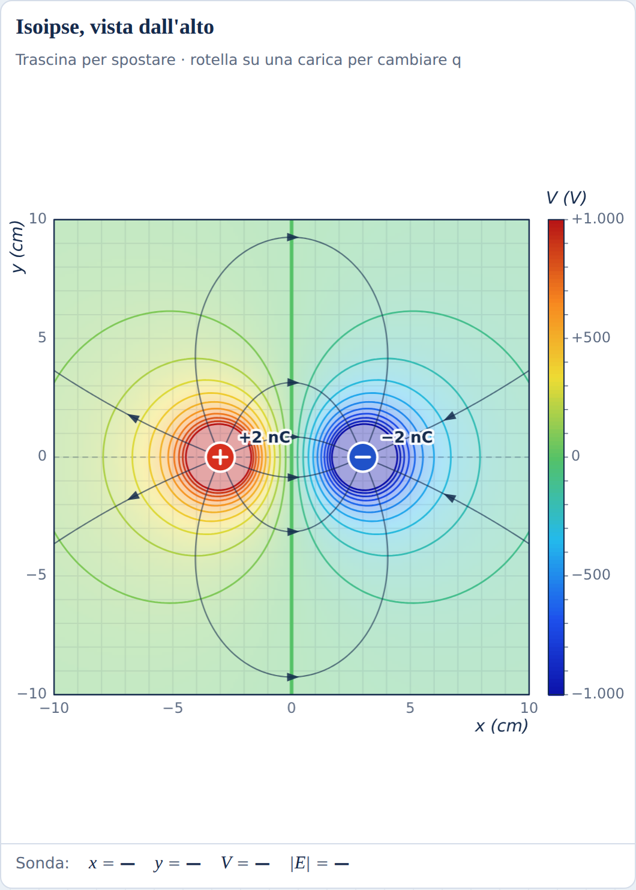

*Figura 3 – Linee di campo (in grigio scuro, con la freccia) e isoipse (colorate) del dipolo: si incontrano sempre ad angolo retto.*

> **Idea chiave.** Il campo è la «pendenza» del potenziale: perpendicolare alle isoipse, diretto verso i potenziali minori, tanto più intenso quanto più le isoipse sono vicine.

> **Prova sul laboratorio.** Scheda 1 → «Dipolo», poi Campo elettrico → «Linee di campo». Controlla che le linee taglino le isoipse ad angolo retto. Passa a «Vettori E»: dove le frecce sono più scure, il campo è più intenso.

> **Misura.** Vicino all'origine, tra due isoipse vicine ci sono 100 V. Stima a occhio la loro distanza usando la griglia (un quadretto = 1 cm), calcola ΔV/Δs in V/m e confronta con il valore |E| che la sonda legge nell'origine.

Ora arriva la domanda che ci porta oltre la geometria. Se lasciamo libera una carica in questo paesaggio, seguirà una linea di campo? Prova a rispondere prima di leggere oltre: la risposta non è quella che si potrebbe attendere.

## 4 · Una carica in movimento

Finora il paesaggio era fermo. Mettiamolo in azione: le cariche fisse creano il campo, e una carica di prova si muove al suo interno. Nel laboratorio è una piccola sfera con q₀ = 1 nC e massa m = 1 g, che scivola senza attrito sul piano.

**Come si calcola un moto.** Sulla carica agisce la forza F = q₀E, quindi la sua accelerazione è:

```latex
\vec a = \frac{q_0\,\vec E}{m}
```

Il laboratorio procede «a piccoli passi»: conosce posizione e velocità, calcola la forza, avanza di un centesimo di secondo e ripete. È il modo in cui si risolvono quasi tutti i problemi di dinamica reali, dalle orbite dei satelliti alle previsioni del tempo.

**Il bilancio dell'energia.** Senza attrito la somma dell'energia cinetica e dell'energia potenziale resta costante:

```latex
K + U = \tfrac12 m v^2 + q_0 V = \text{costante}
```

Quando una carica positiva scende verso potenziali più bassi perde energia potenziale e guadagna velocità: sulla superficie 3D è la pallina che scende dal pendio.

**La traiettoria non è la linea di campo.** Ecco la risposta alla domanda lasciata aperta. La forza dice come *cambia* la velocità, non dove va la carica. Per percorrere una curva servirebbe una forza diretta verso l'interno della curva (la forza centripeta), ma la forza elettrica è diretta lungo la linea di campo, non verso il suo interno. Partendo da ferma, la carica imbocca la linea di campo; poi l'inerzia la porta fuori.

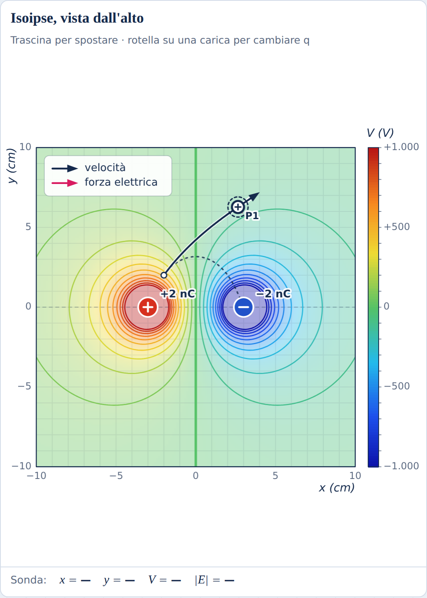

*Figura 4 – Una carica partita da ferma nel dipolo. La linea punteggiata è la linea di campo che passa per il punto di partenza; la traccia scura è la traiettoria vera, che se ne allontana. Le frecce mostrano velocità (scura) e forza (rosa).*

> **Idea chiave.** La forza determina il cambiamento della velocità, non la direzione del moto: in generale la traiettoria di una carica non coincide con la linea di campo. Ciò che resta costante, senza attrito, è l'energia totale K + U.

> **Prova sul laboratorio.** Scheda 2 → «Partenza da ferma nel dipolo». Durante il moto guarda la tabella dell'energia: K e U cambiano, la loro somma no.

> **Prova sul laboratorio.** Premi «Posiziona una carica di prova», poi clicca sulla mappa e, senza rilasciare, trascina: la freccia che disegni è la velocità iniziale. Prevedi la traiettoria, poi premi Avvia (o la barra spaziatrice).

La forza che governa questo moto decresce come 1/r². Dove l'abbiamo già incontrata, questa legge? Nel cielo.

## 5 · Orbite e diffusione

La forza di Coulomb diminuisce come 1/r², esattamente come la gravità di Newton. La somiglianza non è solo formale: una carica di prova attirata da una carica fissa si muove come un pianeta attorno al Sole, e lo stesso calcolo che spiega le orbite spiega anche le collisioni più violente.

**Orbita circolare.** Se la forza elettrica fa da forza centripeta, si ha

```latex
k\,\frac{|q\,Q|}{r^2} = \frac{m v^2}{r} \quad\Rightarrow\quad v = \sqrt{\frac{k\,|q\,Q|}{m\,r}}
```

*Esempio.* Con Q = −2 nC, q₀ = 1 nC, m = 1 g e r = 5 cm si ottiene v ≈ 0,019 m/s = 1,9 cm/s; un giro dura T = 2πr/v ≈ 16,6 s.

**Orbite ellittiche.** Partendo più lentamente, la carica «cade» verso il centro e descrive un'ellisse con la carica fissa in un fuoco: valgono le leggi di Keplero. Con due cariche vicine al centro, invece, la forza non è più esattamente ∝ 1/r² e l'orbita non si chiude: ruota lentamente e disegna una rosetta.

**Diffusione di Rutherford.** Se le cariche si respingono, le traiettorie sono iperboli. Nel 1911 Ernest Rutherford osservò che alcune particelle alfa lanciate contro una sottile lamina d'oro tornavano indietro: un risultato incompatibile con un atomo in cui la carica positiva fosse diffusa, e spiegabile solo se essa è concentrata in un nucleo piccolissimo.

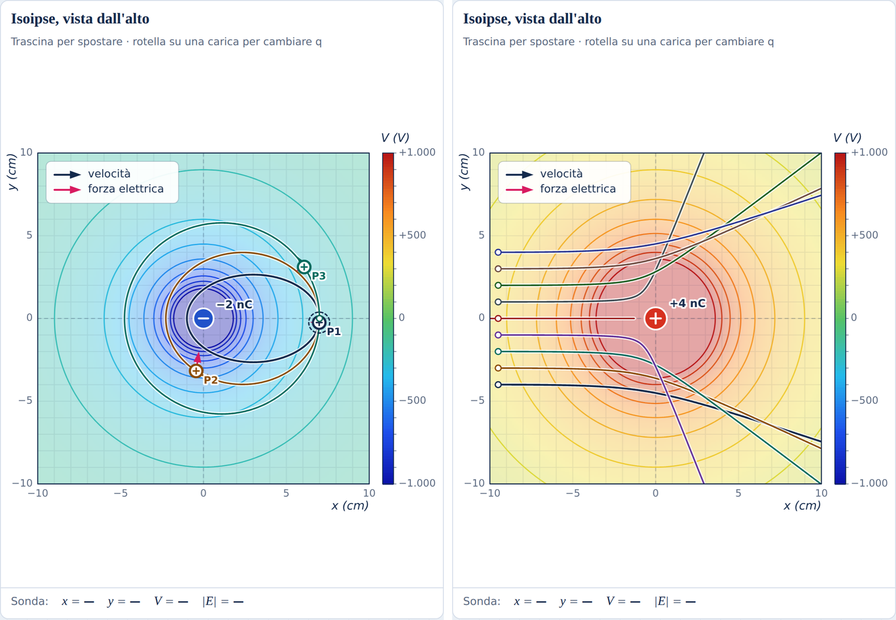

*Figura 5 – A sinistra: tre orbite ellittiche che partono dallo stesso punto con velocità diverse. A destra: un fascio di cariche contro una carica positiva di +4 nC; quella lanciata dritta al centro torna indietro.*

> **Idea chiave.** Con una forza che decresce come 1/r² le orbite sono coniche: ellissi se la carica è attratta, iperboli se è respinta. Lo stesso modello descrive i pianeti e il nucleo atomico.

> **Prova sul laboratorio.** Scheda 2, nell'ordine: «Orbita circolare», «Orbite ellittiche», «Rosetta», «Esperimento di Rutherford», «Deflessione tra due file di cariche». Per ognuna, prima di avviare, prova a prevedere che cosa succederà.

> **Misura.** Nell'orbita circolare usa il cronometro (t, nella barra in basso) per misurare il periodo e confrontalo con 16,6 s. Attenzione alla velocità di riproduzione: a 4× il tempo indicato è comunque quello simulato.

Fin qui abbiamo seguito un viandante alla volta. Ma una fisica che si limita a raccontare singoli viaggi ha un limite: che cosa possiamo dire di *tutti* i viaggi possibili, insieme?

## 6 · Sistemi dinamici e spazio delle fasi

Cambiamo punto di vista. Invece di domandarci dove andrà *questa* carica, ci chiediamo come si comportano tutti i moti possibili. È la domanda con cui, alla fine dell'Ottocento, Henri Poincaré aprì un nuovo modo di fare fisica, e per rispondere ci serve un linguaggio nuovo.

**Lo stato.** Per prevedere il futuro della carica di prova bastano quattro numeri: la posizione (x, y) e la velocità (vₓ, v\_y). Nient'altro. Questi quattro numeri descrivono completamente la situazione in un istante.

> **Definizione.** Lo **stato** di un sistema è l'insieme dei numeri che bastano a determinarne l'evoluzione futura. Un **sistema dinamico** è una regola che, dato lo stato in un istante, dice come cambierà: qui è la seconda legge della dinamica. Se lo stesso stato iniziale porta sempre allo stesso futuro, il sistema è **deterministico**.

**Lo spazio delle fasi.** L'insieme di tutti gli stati possibili è lo **spazio delle fasi**: ogni moto è una curva in questo spazio, e da ogni stato ne passa una sola. Quello della nostra carica ha quattro dimensioni, impossibili da disegnare: il laboratorio ne mostra una «ombra» a due dimensioni, con la posizione x in orizzontale e la velocità vₓ in verticale. Per questo nel grafico le curve possono sembrare incrociarsi: è l'ombra che si sovrappone, non il moto vero.

**Un moto periodico è una curva chiusa.** Nell'orbita circolare la carica ripassa sempre per gli stessi stati: nello spazio delle fasi percorre un'ellisse, sempre la stessa.

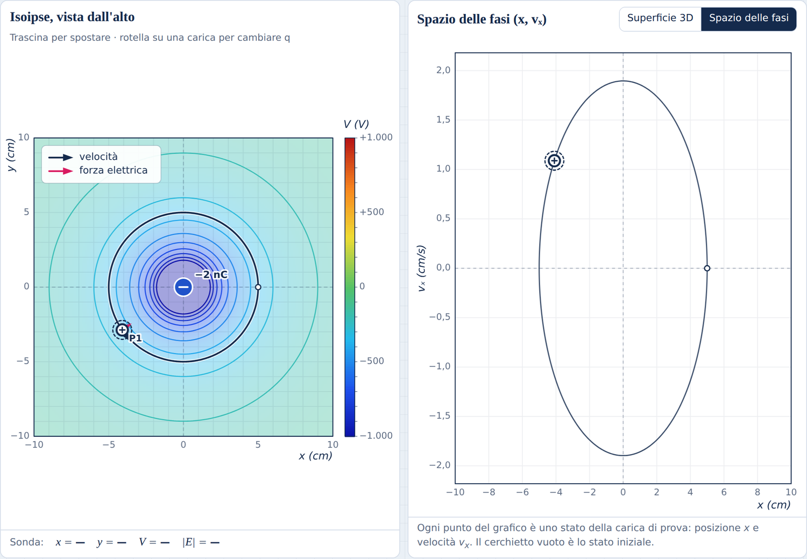

*Figura 6 – L'orbita circolare: a sinistra la traiettoria nel piano, a destra la stessa orbita nello spazio delle fasi (x, vₓ), un'ellisse percorsa sempre uguale.*

Nelle prossime sezioni incontreremo quattro comportamenti tipici. La figura seguente li riassume come una mappa del viaggio: ogni riquadro è uno spazio delle fasi.

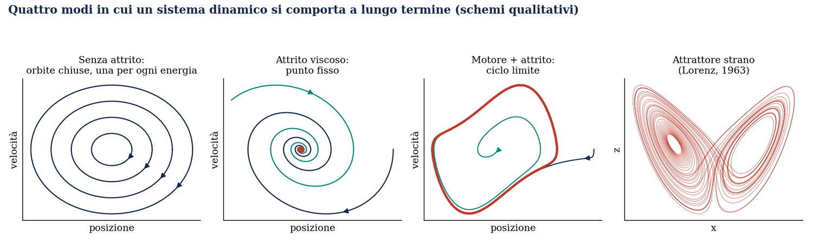

*Figura 7 – Schemi qualitativi. Senza attrito: una curva chiusa per ogni energia. Con attrito: tutto converge in un punto. Con «motore» e attrito: tutto converge su una curva chiusa (ciclo limite). Infine l'attrattore strano di Lorenz.*

> **Idea chiave.** Lo spazio delle fasi trasforma il moto in una figura geometrica: studiare il comportamento a lungo termine di un sistema significa studiare la forma delle curve che vi disegna.

> **Prova sul laboratorio.** Scheda 2 → «Orbita circolare», poi nel grafico di destra scegli «Spazio delle fasi». Prova poi «Orbite ellittiche»: tre curve chiuse diverse, una per ogni velocità iniziale. Cambiando di poco la velocità iniziale, l'orbita cambia di poco: resta su un'ellisse vicina.

Tutte le curve di questa sezione sono state tracciate senza attrito: il sistema ricorda per sempre come è partito. Che cosa succede se gli permettiamo di dimenticare?

## 7 · Punto fisso e ciclo limite

Senza attrito un sistema conserva memoria perfetta delle condizioni iniziali: la sua energia resta quella di partenza. Con l'attrito, invece, dimentica, e moti partiti in modi diversi possono finire nello stesso modo. Il comportamento verso cui tendono si chiama attrattore.

> **Definizione.** Un **attrattore** è l'insieme di stati verso cui tendono, col passare del tempo, le traiettorie che partono da una regione dello spazio delle fasi.

**Attrito viscoso.** Nel laboratorio (scheda 3) puoi aggiungere una forza F = −mγv, opposta alla velocità, come la resistenza dell'aria: l'energia K + U diminuisce sempre.

**Il punto fisso.** Mettiamo la carica di prova positiva dentro un anello di cariche positive: al centro le spinte si bilanciano e la forza è nulla. Con l'attrito, da qualunque punto parta, la carica finisce ferma al centro. Nello spazio delle fasi lo stato «carica ferma al centro» è un punto, e le traiettorie vi arrivano a spirale: è un **punto fisso stabile**.

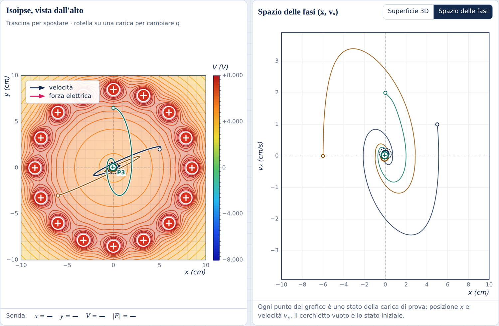

*Figura 8 – Tre cariche di prova partite da punti diversi dentro l'anello. A destra, nello spazio delle fasi, tre spirali che finiscono nello stesso punto.*

**Il ciclo limite.** Ora sostituiamo l'attrito con un «motore»: una forza che spinge la carica quando è più lenta di una velocità v\* e la frena quando è più veloce. Il sistema riceve energia quando ne ha poca e la cede quando ne ha troppa. Risultato: partendo da dentro o da fuori, la carica finisce sempre sullo stesso giro, un cerchio di circa 3,1 cm di raggio percorso esattamente a velocità v\*. Questa orbita isolata che attira le altre è un **ciclo limite**.

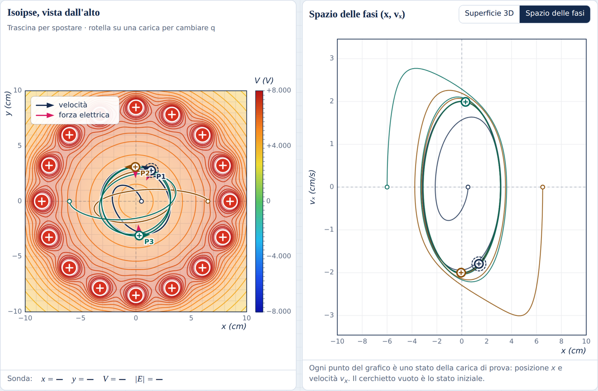

*Figura 9 – Tre partenze diverse, una vicino al centro e due lontane: nello spazio delle fasi tutte le curve si avvolgono sulla stessa curva chiusa.*

Conviene fermarsi sulla differenza con le orbite della sezione 5: lì ogni velocità iniziale dava un'orbita diversa, qui l'orbita finale è sempre la stessa, qualunque sia la partenza. È la ragione per cui i cicli limite compaiono dove un fenomeno si ripete sempre uguale: il battito del cuore, il ticchettio di un orologio a pendolo, il suono di una corda di violino strofinata dall'archetto.

> **Idea chiave.** Con la dissipazione il sistema perde memoria: moti partiti in modi diversi convergono sullo stesso attrattore, un punto fisso (quiete) o un ciclo limite (oscillazione stabile).

> **Prova sul laboratorio.** Scheda 3 → «Prova: il punto fisso», poi «Prova: il ciclo limite». Il grafico di destra passa da solo allo spazio delle fasi. Poi aggiungi tu una carica di prova in un punto qualsiasi dentro l'anello: dove finisce?

> **Curiosità.** Nello spazio a tre dimensioni nessuna disposizione di cariche ferme può tenere un'altra carica in equilibrio stabile (teorema di Earnshaw). Qui funziona perché la carica è costretta a restare sul piano.

Quiete e oscillazione regolare sono attrattori semplici. Ne esiste un terzo tipo, molto meno ovvio, ed è quello in cui la regolarità scompare.

## 8 · Caos e attrattori strani

Un sistema dinamico è deterministico: lo stesso stato iniziale dà sempre lo stesso futuro. Se così fosse sempre, conoscendo esattamente lo stato di oggi potremmo prevedere il futuro. Il punto è nella parola *esattamente*: nessuna misura è perfetta, e in certi sistemi un errore piccolissimo cresce fino a rendere il futuro imprevedibile. Questo è il **caos**.

> **Definizione.** Un sistema è **caotico** quando è deterministico ma due stati iniziali arbitrariamente vicini si allontanano in modo esponenziale: la previsione a lungo termine è impossibile pur essendo la legge perfettamente nota.

**Non tutto è caotico.** Il moto attorno a una o due cariche fisse è regolare: si può prevedere per sempre. Con tre ostacoli al centro di un anello di cariche, il «biliardo elettrico», le cose cambiano.

**Sensibilità alle condizioni iniziali.** Lanciamo nel biliardo due cariche che partono a 0,2 mm di distanza, con la stessa velocità. Per un po' viaggiano appaiate, poi le loro strade si separano del tutto.

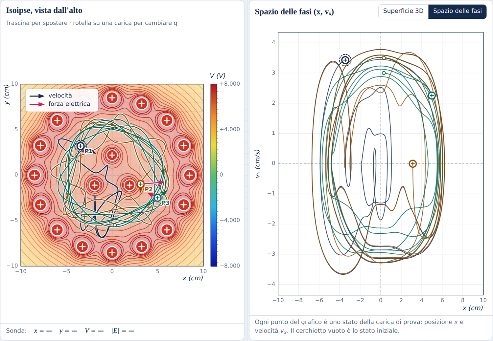

*Figura 10 – Il biliardo elettrico: P1 e P2 partono quasi dallo stesso punto e finiscono su traiettorie diversissime; P3, un po' più lenta, resta su un moto ordinato.*

Il grafico seguente misura la distanza tra due cariche partite a solo 10⁻⁶ cm l'una dall'altra. La scala verticale è logaritmica: ogni tacca vale dieci volte la precedente.

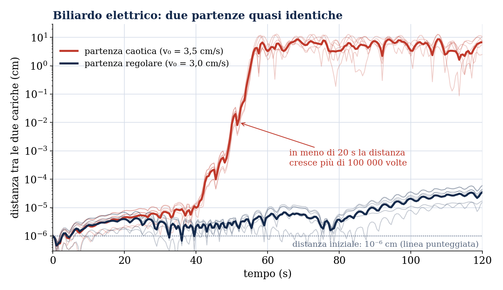

*Figura 11 – In rosso, due partenze nella zona caotica: dopo circa 40 s la distanza cresce in modo esponenziale e in meno di 20 s si moltiplica per più di 100 000. In blu, due partenze nella zona regolare: la distanza resta piccolissima.*

Le conseguenze sono pratiche. Quando l'errore cresce in modo esponenziale, migliorare la misura serve poco: misurare la posizione iniziale dieci volte meglio fa guadagnare solo pochi secondi di previsione, non dieci volte tanto. È per questo che le previsioni del tempo valgono solo per pochi giorni.

**Senza attrito, niente attrattori.** Nel biliardo l'energia si conserva, quindi ogni partenza resta per sempre al proprio livello di energia: le traiettorie non possono convergere verso uno stesso insieme.

**L'attrattore strano.** Aggiungiamo al biliardo il «motore» della sezione 7. Ora succedono due cose insieme: da qualunque punto parta, la carica finisce sempre nella stessa regione dello spazio delle fasi (c'è un attrattore), ma su questa regione il moto è caotico e non si ripete mai. Un attrattore così, intricato e caotico, si chiama **attrattore strano**. Il più famoso fu scoperto da Edward Lorenz nel 1963 studiando un modello dell'atmosfera: ha la forma di una farfalla (figura 7).

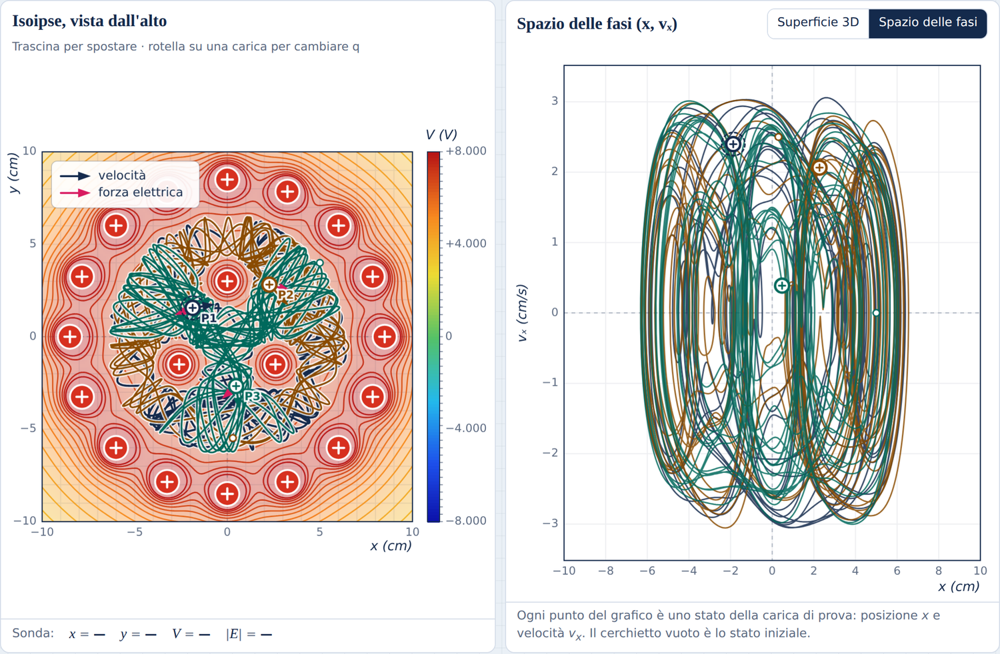

*Figura 12 – Dopo circa 230 s simulati: a sinistra le traiettorie nel piano, a destra lo spazio delle fasi riempito da una struttura intricata ma limitata.*

> **Idea chiave.** Determinismo non significa prevedibilità: nel caos la legge è esatta, ma l'errore sull'inizio cresce così in fretta da cancellare ogni previsione a lungo termine. L'ordine sopravvive solo nella forma dell'attrattore.

> **Prova sul laboratorio.** Scheda 3 → «Prova: il biliardo elettrico», velocità 4×. Segui P1 e P2: dopo quanto tempo si separano? E P3?

> **Prova sul laboratorio.** Scheda 3 → «Prova: l'attrattore strano», velocità 8×, schermo intero con «Solo fasi». Lascialo correre due minuti e guarda la forma che si costruisce. Poi aggiungi una nuova carica di prova in un punto lontano: finisce nella stessa regione?

L'ultima sorpresa del percorso riguarda un caso in cui la fine di ogni viaggio è semplice, e l'incertezza riguarda soltanto *quale* fine sarà.

## 9 · Bacini di attrazione frattali

Esistono sistemi in cui ogni moto termina in modo semplice, senza caos, eppure è impossibile prevedere dove. Lo scopriamo tornando alle cariche, con l'attrito della sezione 7.

**Più attrattori.** Dentro l'anello di cariche positive mettiamo tre cariche negative. Con l'attrito, la carica di prova lasciata ferma in un punto qualsiasi finisce sempre su una delle tre: ci sono tre attrattori, e per ogni punto di partenza il destino è uno solo.

> **Definizione.** Il **bacino di attrazione** di un attrattore è l'insieme dei punti di partenza le cui traiettorie finiscono su quell'attrattore.

Per disegnarlo il laboratorio fa partire una carica da ciascuno di 10 000 punti (o 22 500 nella versione «Fine»), segue ogni moto fino alla fine e colora il punto di partenza con il colore della carica su cui la carica di prova è caduta.

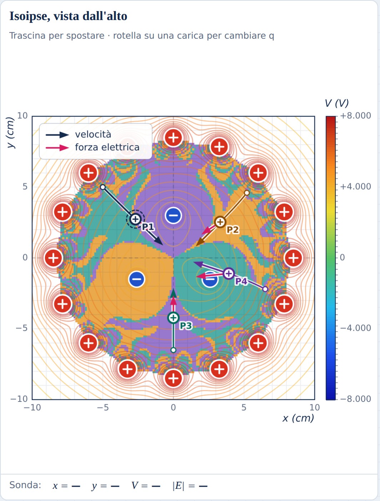

*Figura 13 – Mappa dei bacini (150 × 150 partenze). Ogni colore è l'insieme dei punti di partenza che finiscono sulla stessa carica negativa.*

Guarda la mappa: vicino a ogni carica c'è una zona grande di un solo colore, dove il destino è sicuro. Più lontano i tre colori si alternano in strisce sottili. Ingrandendo un pezzo di confine, le strisce non diventano mai lisce: compaiono strisce sempre più sottili, e spesso tra due strisce se ne infila una del terzo colore.

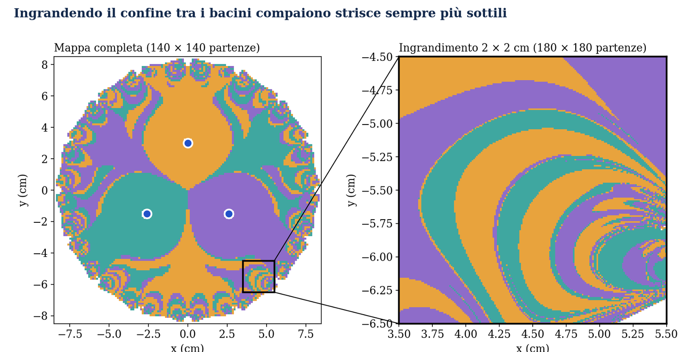

*Figura 14 – Un quadrato di 2 × 2 cm vicino all'anello, ricalcolato con 32 400 partenze: il confine è formato da strisce sempre più fini. È un frattale.*

> **Definizione.** Un **frattale** è una figura che mostra nuovi dettagli a ogni ingrandimento.

Il confine tra i bacini è di questo tipo: per quanto precisa sia la misura del punto di partenza, vicino al confine l'errore può bastare per cambiare il destino finale. Lo stesso disegno compare nel «pendolo magnetico», un pendolo che oscilla sopra tre calamite, e perfino nella matematica pura, quando si risolve l'equazione z³ = 1 con il metodo di Newton.

> **Idea chiave.** Un sistema può essere semplice in ogni sua parte (nessun caos nel moto) e tuttavia imprevedibile nel risultato: se il confine tra i bacini è un frattale, nessuna precisione finita sulla partenza garantisce di conoscere la meta.

> **Prova sul laboratorio.** Scheda 3 → «Prova: tre attrattori». La mappa si costruisce da sola in una decina di secondi. Rifalla con «Fine» e confronta i confini.

> **Esperimento.** Cambia il coefficiente γ dell'attrito (prima 0,1 s⁻¹, poi 0,4 s⁻¹) e ricalcola la mappa. Con meno attrito i confini diventano più intricati o più semplici? Perché?

Siamo partiti da una carica e da una forza. Abbiamo costruito un paesaggio, lo abbiamo percorso, abbiamo guardato dall'alto tutti i viaggi possibili e abbiamo scoperto che anche in un mondo regolato da una legge esatta il futuro può non essere conoscibile. È un risultato che ha cambiato il modo di pensare la scienza: la fisica non promette di prevedere tutto, ma di capire che cosa si può prevedere e con quale precisione.

## Mettiti alla prova

Tra parentesi la sezione a cui si riferisce ogni domanda. Dove serve, usa k = 8,99·10⁹ N·m²/C².

1. (1) Una carica di +3 nC è ferma nell'origine. Quanto vale il potenziale a 6 cm? Che lavoro compie la forza elettrica quando una carica di +1 nC passa da 6 cm a 3 cm?
2. (2) Perché due isoipse diverse non possono incrociarsi?
3. (2–3) Nel dipolo del laboratorio, nell'origine V = 0. Vuol dire che anche il campo è nullo? Controlla con la sonda.
4. (3) Due isoipse distano 0,5 cm e differiscono di 100 V. Stima l'intensità del campo in V/m.
5. (4) Una carica parte da ferma vicino a una sola carica fissa positiva. Segue la linea di campo? E se le cariche fisse sono due, come nel dipolo?
6. (5) In un'orbita circolare il raggio raddoppia. Come cambiano la velocità e il periodo?
7. (5) Calcola la distanza minima dal centro nell'urto frontale del preset Rutherford: carica fissa +4 nC, q₀ = 1 nC, m = 1 g, velocità iniziale 7 cm/s. Suggerimento: nel punto più vicino tutta l'energia cinetica è diventata potenziale.
8. (6–7) Qual è la differenza tra le orbite ellittiche della sezione 5 e il ciclo limite della sezione 7?
9. (8) Perché in un sistema senza attrito non può esserci un attrattore?
10. (8) Se misuri la posizione iniziale dieci volte meglio, puoi prevedere il moto caotico per un tempo dieci volte più lungo?
11. (9) Nella mappa dei bacini, perché vicino ai confini è impossibile dire su quale carica finirà la carica di prova?
12. (9, sul laboratorio) Ricalcola la mappa dei bacini con γ = 0,1 s⁻¹ e con γ = 0,4 s⁻¹. Come cambiano i confini?
